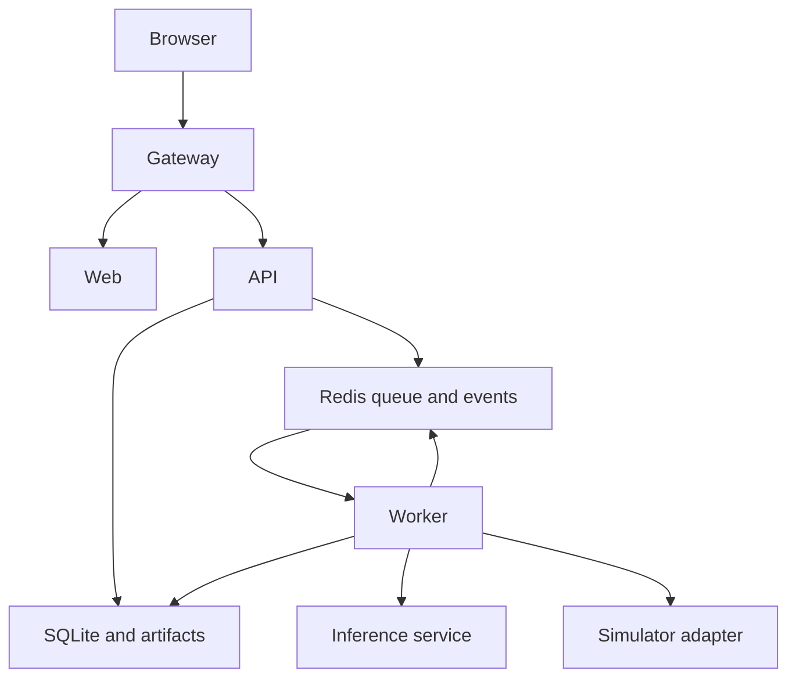

# Runtime architecture

Use one monorepo and a small Compose deployment. Services are web, gateway, api, worker, redis and inference. Ops profile adds Prometheus/Grafana/MLflow. API and worker share local persistent application data; inference mounts verified weights read-only. All internal services use private networking.

API handles authentication/validation/status and never performs blocking video inference in its request loop. Redis/RQ handles job dispatch. A worker decodes/annotates videos or runs a simulator session. The internal inference service initializes the learned model once and serializes execution; it has its own readiness health and internal HTTP interface. API/worker image need not contain Torch. RQ's job process sends inference calls over the internal service instead of inheriting a loaded CUDA context. Use RQ's supported job cancellation signals plus persistent cancellation flags checked between frames; do not treat killing a process as successful cleanup.

## Layout to implement
- `frontend/`: app, routes, components, i18n, generated API types, Playwright tests.
- `backend/app/api/`, `schemas/`, `storage/`, `jobs/`, `reporting/`.
- `backend/app/perception/`: client, tracking, world-state transformations.
- `inference/app/`: model loading, checkpoint verification, preprocessing/postprocessing.
- `backend/app/agents/`, `navigation/`, `control/`, `simulators/`, `evaluation/`.
- `tests/unit`, `integration`, `model_smoke`, `scenarios`, `security`.
- `deploy/`, `ops/`, `scripts/`, `config/`, `contracts/`, `docs/`.

## Shared contracts
Use Pydantic schemas matching `contracts/`. Pixel detections/masks have original image dimensions, frame/time/source/model metadata. Navigation receives only route graph and ego localization. Safety/FSM receive perception and bounded ego telemetry. Controller never imports evaluation truth. Simulator adapter exposes distinct methods for camera, ego, route topology, actuation and evaluator-only truth. Static route topology is permitted; dynamic actor truth is not a runtime perception input.

## Persistence and failure
SQLite WAL is acceptable for a single node with this bounded queue. Store migrations, jobs, runs, owners, progress and immutable manifest references. Artifacts are UUID-named directories in a Docker volume; paths returned by clients are never filesystem paths. Atomic report/output moves prevent partial success. Redis is not the only source of job history. On worker restart, reconcile abandoned running jobs as interrupted; do not retry the same job silently forever. Data volumes require backup/restore; not NFS for SQLite WAL. Scaling beyond one node requires replacing the shared DB/storage design, not merely adding API replicas.

Inference startup fails readiness on missing/bad hash/incompatible weights. App liveness can stay healthy with `capabilities.video_analysis=false`; uploads return structured 503. A missing model must never generate mock inference. CPU/CUDA selection is explicit with tested FP32/FP16 paths and one loaded model. GPU OOM records a failed/degraded run; only use CPU retry if configured and labeled, not silent partial results.

## Events and camera transport
Use SSE `/api/v1/events` for small versioned state messages and job progress. Use latest JPEG endpoints for simulator camera frames, returning the matching frame ID in headers. Worker writes latest frame bytes/state to Redis with TTL; publish IDs, not huge base64 events. Slow clients receive latest state and resync via REST, not an unbounded frame backlog. Stored video results use HTML video with byte-range serving. Same-origin gateway routes everything; no build-time hardcoded API hostname.

Start with one active simulation exclusive of the video worker. API reports waiting/busy states and bounded queued work. Measure wall latency separately from simulated time; synchronous mode may run slower than real time.
